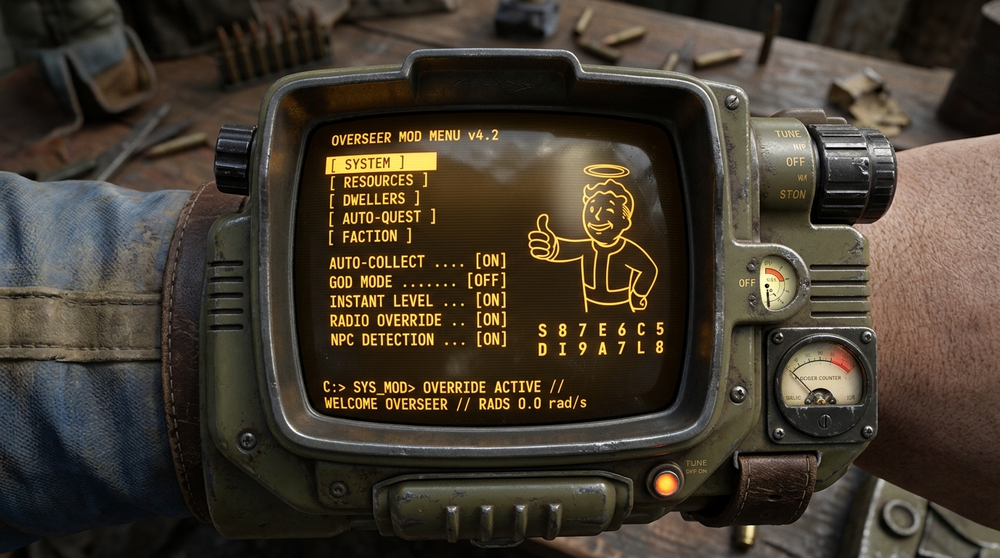

# Fallout Shelter - Pip-Boy Terminal Mod Menu & Ultimate Cheats

[](https://opensource.org/licenses/MIT)
[-green.svg)](https://store.steampowered.com/app/588430/Fallout_Shelter/)
[](https://github.com/BepInEx/BepInEx)
[](#bilingual-support)

A comprehensive **RobCo Pip-Boy 3000 CRT Terminal** overhaul, cheat suite, and quest automation engine for **Fallout Shelter (PC / Steam)**.



---

## 🌟 Key Features

### 1. 🎨 10 Authentic Fallout Faction & Holiday Themes
Switch themes instantly with a single click using header navigation arrows:
* 🛡️ **Brotherhood of Steel (BoS):** Tactical steel grey with high-voltage amber CRT phosphor.
* 🤖 **The Institute:** Synth obsidian frame with cybernetic neon cyan terminal lines.
* ⚡ **Minutemen:** Colonial Commonwealth navy with Freedom Radio electric gold.
* 🏮 **The Railroad:** Stealth charcoal with covert lantern amber.
* 🥤 **Party Mode (Nuka-World):** Arcade neon hot pink with Quantum blue highlights.
* ⚙️ **Vault 33:** Classic Vault-Tec royal navy and golden yellow.
* 🎃 **Halloween Special:** Spooky midnight purple with radioactive pumpkin orange.
* 🎄 **Christmas Celebration:** Evergreen pine with holiday candy-apple red.
* 🦃 **Thanksgiving Gathering:** Warm autumn hearth brown with roasted harvest amber.
* 🎰 **New Vegas (Mr. House):** Lucky 38 penthouse black with Strip neon gold.

### 2. 🖥️ Authentic Pip-Boy CRT Terminal Aesthetic
* **Glass Reflections & Glow:** Custom CRT scanlines, curved bezel highlights, and glowing borders.
* **Interactive Hover Luminescence:** Buttons light up with the active faction's accent color on mouseover.
* **No Tab Overflow:** Smart multi-row dynamic category wrapping ensures zero border clipping across all resolutions.
* **Non-Intrusive HUD Button:** Positioned neatly below the dweller count icon, blending seamlessly with the vanilla HUD.
* **Responsive Scale Slider:** Resize the entire UI from 50% to 200% on the fly.

### 3. 🌐 Bilingual Support (English & Turkish)
* **Instant Toggle:** Click `LANG: EN` / `DİL: TR` in the top right corner to switch languages at runtime.
* **100% Localization:** Over 47 cheat buttons, descriptions, 11 categories, faction mottos, and tooltips are localized.

### 4. 🛡️ Crash-Free Dweller Leveling (`Safe Max Level Dwellers`)
* Fixes the notorious FSCheat crash where leveling 20+ dwellers caused thread blocking and game freezes.
* Safely processes up to 200 dwellers smoothly to Level 50 with zero frame drops.

### 5. 🗺️ FSAutoQuest (100% Full-Dungeon Sweeper & Automation)
* **100% Dungeon Sweeper:** Explores every room in quest layouts, sweeps 100% of containers (safes, desks, lockers), claims enemy corpse loot, and leaves zero items behind.
* **Smart Auto-Kill (/autokill):** Instantly eliminates hostile creatures while strictly protecting player dwellers, rescued wastelanders, and dialogue NPCs. Satisfies boss/kill objectives with full XP.
* **Auto-Collect Recipes & Popups (/autocollect):** Automatically claims theme recipe fragments, blueprints, and closes post-quest dialogs during AFK farming.
* **Quest God Mode & Instant Return:** Dwellers become invulnerable with instant revive, and returning teams skip wasteland travel to appear directly at the Vault door.
* **Bypass Quest Requirements:** Removes all dweller level requirements, required weapons (Gauss Rifle, etc.), outfits, and SPECIAL stat thresholds.

### 6. ⏱️ Integrated V.A.T.S. (Vault Accelerated Time System)
* **10x Time Boost & 50x Time Warp:** Accelerate production, training, crafting, and wasteland exploration without save editing.
* **Smart Auto-Pause:** Resets to 1.0x during disasters (fires, raiders, radscorpions, deathclaws) and pauses when the Mysterious Stranger appears.
* **CRT HUD Overlay:** Real-time elapsed time counters and scanline effects while boosted.

### 7. 🚨 Dedicated Event Manager (Raids, Disasters & Encounters on Demand)
* **On-Demand Invader Attacks:** Trigger custom attacks at the Vault door: Raiders, ferocious Deathclaws, Alien invaders, Feral Ghouls, Institute Synths, and Enclave soldiers.
* **On-Demand Room Emergencies:** Trigger Radscorpion infestations, Molerat swarms, Radroaches, or room fires at will.
* **Summon Special Visitors:** Call the Mysterious Stranger with piano chime or summon Bottle & Cappy for dancing and rewards.
* **Stop All Incidents & Defeat Invaders:** One-click instant rescue that extinguishes fires, clears infestations, and defeats all attackers.
* **Auto-Defend (/eventautodefend) & Auto-Tap (/eventautotap):** Permanent toggles for hands-free vault protection and reward harvesting.

### 8. ⚡ 50+ In-Game Cheats & Tweaks
* **Resources:** Infinite Nuka Caps, Quantum, Lunchboxes, Pet Carriers, Mr. Handy Boxes, Stimpaks, and Radaways.
* **Dwellers:** Spawn custom/legendary dwellers, max SPECIAL attributes, instant adult/birth, 100% happiness, remove population caps.
* **Rooms & Crafting:** Free crafting (no scrap/quantum needed), unlock all weapon/outfit recipes, 0% rush failure.
* **Pets & Weapons:** Overpowered pets (x1000 multiplier effect), maximum weapon damage overrides.
* **Save Decryption:** Decrypt vault save files directly to editable `.json` format and re-encrypt back into the game.

---

## 🎮 Controls & Usage

| Input | Action |
| :--- | :--- |
| **`F4`** | Toggle the Pip-Boy Mod Menu |
| **`⚙ MOD MENU (F4)` Button** | Click HUD button below dweller icon to toggle menu |
| **`LANG: EN` / `DİL: TR`** | Instant language toggle (upper-right corner) |
| **`◄` / `►`** | Cycle through all 10 themes |
| **`Scale Slider`** | Adjust UI scale to fit your monitor resolution |

---

## 📥 Installation

### Method 1: Ready-to-Play Full Pack (Recommended)
1. Download `FalloutShelter_PipBoyModMenu_FullPack_v1.0.0.zip` from [Releases](https://github.com/TheCrimsonborn/FalloutShelter-PipBoy-ModMenu/releases).
2. Extract all contents directly into your Fallout Shelter root game directory:
   ```text
   C:\Program Files (x86)\Steam\steamapps\common\Fallout Shelter\
   ```
3. Launch the game normally via Steam.

### Method 2: Plugins Only (For Existing BepInEx Users)
1. Download `FalloutShelter_PipBoyModMenu_PluginsOnly_v1.0.0.zip`.
2. Extract the `.dll` files into your `Fallout Shelter\BepInEx\plugins` folder.

---

## 🛠️ Building from Source

The project includes an automated PowerShell build script using Roslyn:

```powershell
# Compile DLLs and install directly to game plugins directory:
.\build.ps1 -Install

# Build and package clean distribution ZIPs:
.\package_release.ps1 -Version "1.0.0"
```

---

## 📜 Credits & Acknowledgments

* **[Toemmsen96](https://github.com/Toemmsen96):** Original developer of `CTDynamicModMenu` and `FSCheats`.
* **[BepInEx Team](https://github.com/BepInEx/BepInEx):** Unity modding and hooking framework.
* **Bethesda Game Studios:** For Fallout Shelter and the Fallout universe.

---

## ⚖️ License

This project is licensed under the [MIT License](LICENSE).
